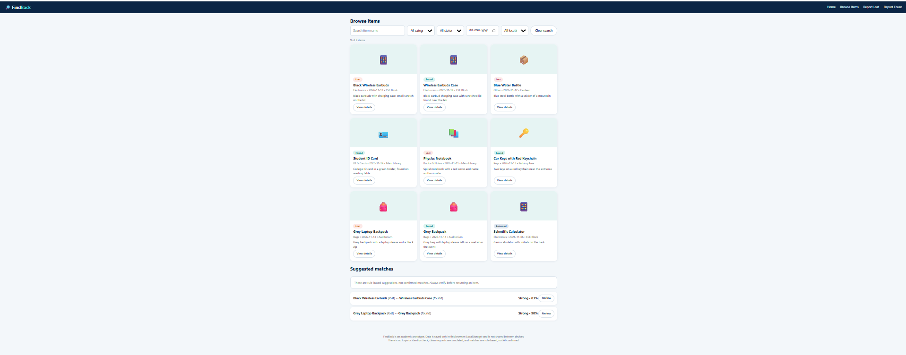
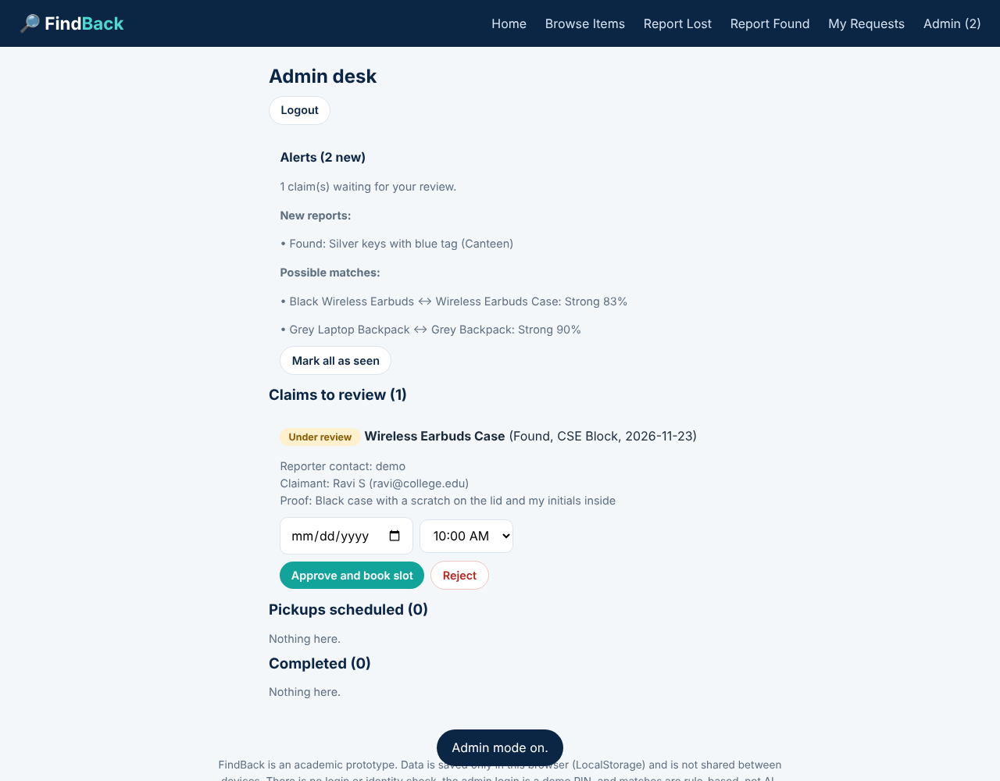
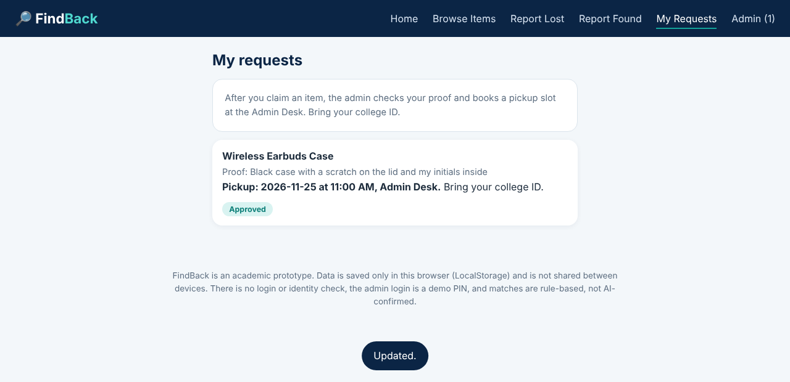

# 🔎 FindBack – Campus Lost-and-Found System

> **Lost Something? Let’s Find It Back.**

FindBack is a browser-based campus lost-and-found desk. An **admin sits between the person who lost an item and the person who found it**. The admin checks proof, books a pickup slot and returns the item in person. It is an academic prototype built for the Innovation Project (TRL 1–3).

**Live demo:** [Open FindBack](https://mano-t-207.github.io/findback/)

**Report:** [TRL 1-3 Report](FindBack-TRL-Report.pdf)

**Author:** Mano T | CSE | KPR Institute of Engineering and Technology

## Problem
Lost items are reported through WhatsApp groups and notice boards. These are scattered and hard to search, and there is no safe way to check that a claimant is the real owner.

## How it works
1. **Loser** reports the item as Lost.
2. **Finder** hands the item to the Admin Desk and reports it as Found.
3. **Loser** finds the item under Found and claims it with proof (description and optional photo).
4. **Admin** reviews the proof, then approves and books a pickup slot, or rejects with a reason.
5. **Loser** checks **My Requests** for the status and slot, then visits the Admin Desk with a college ID.
6. **Admin** checks the person in front of them and marks the item **Returned**.

Item status: Lost / Found → Claim Pending → Ready for Pickup → Returned.

## Features
- Report lost or found items with a photo (gallery or camera), category, date and location
- Search and filter by name, category, status, date and location
- **Possible matches** inside each item's details, with strength, percentage and reasons
- **Claim with proof**, **My Requests** page, and an **Admin Desk** with slot booking (no double booking)
- **Private contacts:** phone and email are visible only to the admin
- Edit and delete your own reports; responsive layout for mobile, tablet and desktop

## Match scoring
| Rule | Points |
|---|---|
| Same category | 30 |
| Similar item name | up to 30 |
| Similar description | up to 20 |
| Same location | 10 |
| Dates within 3 days | 10 |

Strong = 65+, Medium = 45–64, Weak = 30–44. These are suggestions, not confirmed matches.

## Try the admin
Open the **Admin** page and log in with the demo PIN `admin123`.

## Tech stack
HTML5 • CSS3 • Vanilla JavaScript • Browser LocalStorage (no backend, no paid API)

## How to run
1. Download or clone this repository.
2. Open `index.html` in any modern browser.

`FindBack-single-file.html` is the same app in one file.

## Files
```
index.html   – page structure
style.css    – styling
script.js    – logic (storage, validation, search, matching, claims, admin)
```

## Screenshots







## TRL status
| Level | Status |
|---|---|
| TRL-1 | Concept and problem documented (this README + report) |
| TRL-2 | Partial prototype (report form, browse, LocalStorage) |
| TRL-3 | Working prototype with search, matching, admin verification, slot booking and report |

## Limitations
- Reports and claims are stored only in each browser and are not shared between devices
- The admin login is a demo PIN in the code, so it is not secure
- Contacts are hidden on screen but stored in browser storage
- No real student login; matches are rule-based, not AI-confirmed

## Roadmap (TRL-4)
- Firebase shared database, real login and a real admin role with security rules
- Admin alerts for new reports, claims and strong matches
- Slot release and student slot choice; image and text similarity for matching
- Demo video and college event pilot
