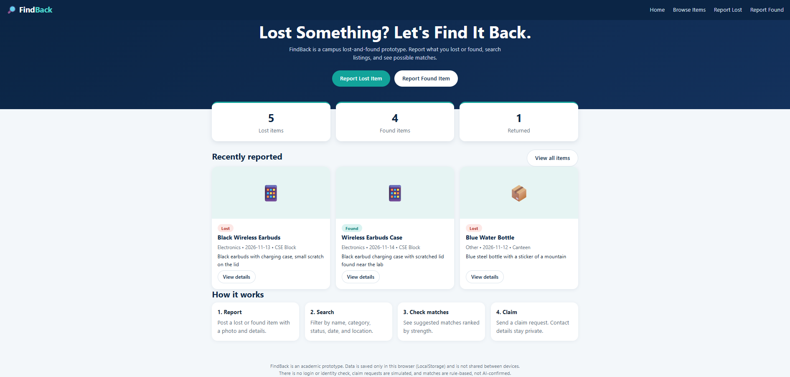
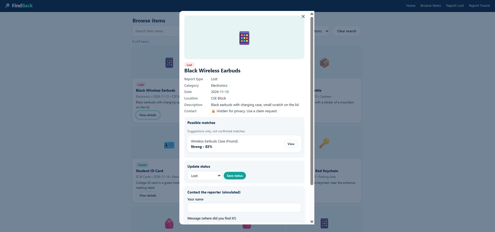
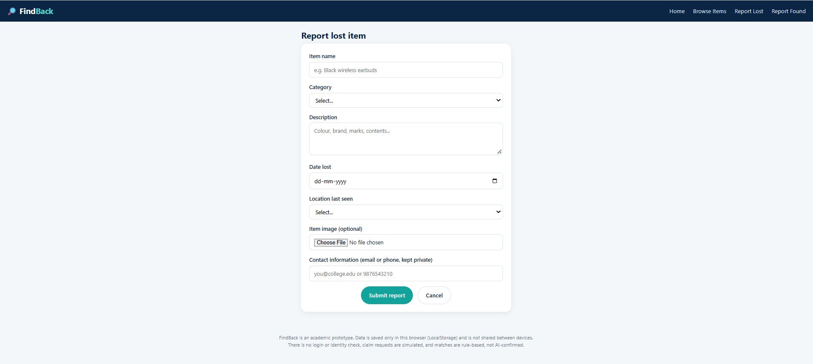

# 🔎 FindBack – Campus Lost-and-Found System

> **Lost Something? Let’s Find It Back.**

FindBack is a browser-based web app where college students report lost or found items, search listings, and see suggested matches. It is an academic prototype built for the Innovation Project (TRL 1–3).

**Live demo:** [Open FindBack](https://mano-t-207.github.io/findback/)
**Author:** [Mano T] | [CSE] | [KPRIET]

## Problem
Lost items are reported through WhatsApp groups and notice boards. These are scattered and hard to search, and there is no safe way to check that a claimant is the real owner.

## Features
- Report lost or found items with photo, category, date and location
- Browse items as cards with Lost / Found / Possible Match / Returned status
- Search and filter by name, category, status, date and location
- **Rule-based match suggestions** with a strength label (Strong, Medium, Weak)
- **Privacy-first claims:** contact details stay hidden and a simulated claim request is used
- Edit and delete your own reports; statistics update automatically
- Responsive layout for mobile, tablet and desktop

## Match scoring
| Rule | Points |
|---|---|
| Same category | 30 |
| Similar item name | up to 30 |
| Similar description | up to 20 |
| Same location | 10 |
| Dates within 3 days | 10 |

Strong = 65+, Medium = 45–64, Weak = 30–44. These are suggestions, not confirmed matches.

## Tech stack
HTML5 • CSS3 • Vanilla JavaScript • Browser LocalStorage (no backend, no paid API)

## How to run
1. Download or clone this repository.
2. Open `index.html` in any modern browser.

`FindBack-single-file.html` is the same app in one file.

## Files
```
index.html   – page structure
style.css    – styling
script.js    – logic (storage, validation, search, matching)
```

## Screenshots



 

## TRL status
| Level | Status |
|---|---|
| TRL-1 | Concept and problem documented (this README + report) |
| TRL-2 | Partial prototype (report form, browse, LocalStorage) |
| TRL-3 | Working prototype with search, matching, status tracking and report |

## Limitations
- Data is stored only in each browser and is not shared between devices
- No login or identity verification
- Claim requests are simulated
- Matches are rule-based, not AI-confirmed

## Roadmap
- Firebase/Supabase for shared data and login (TRL-4)
- Real email/push notifications
- Image and text similarity for better matching
- Demo video and college event pilot (TRL-4 / TRL-5)
